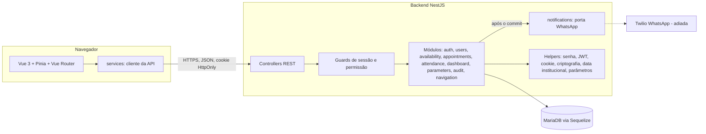
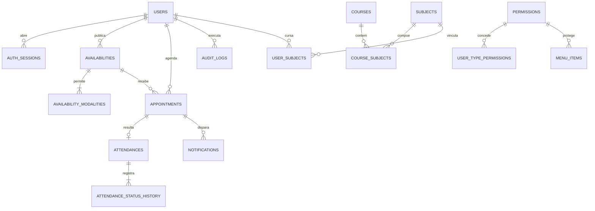
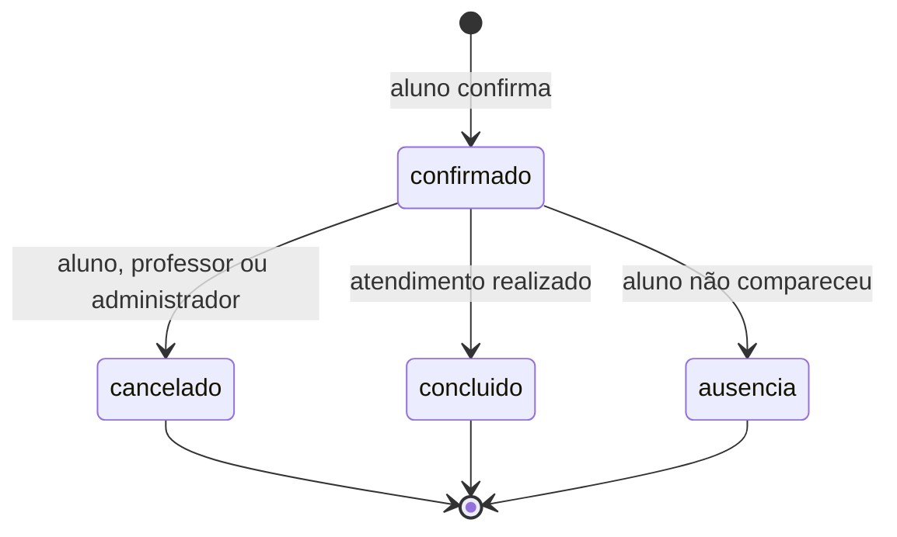
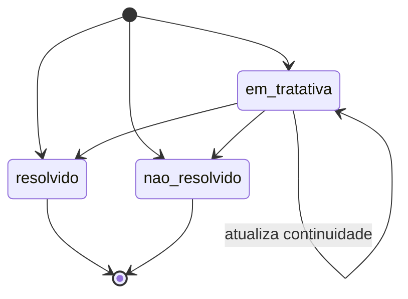
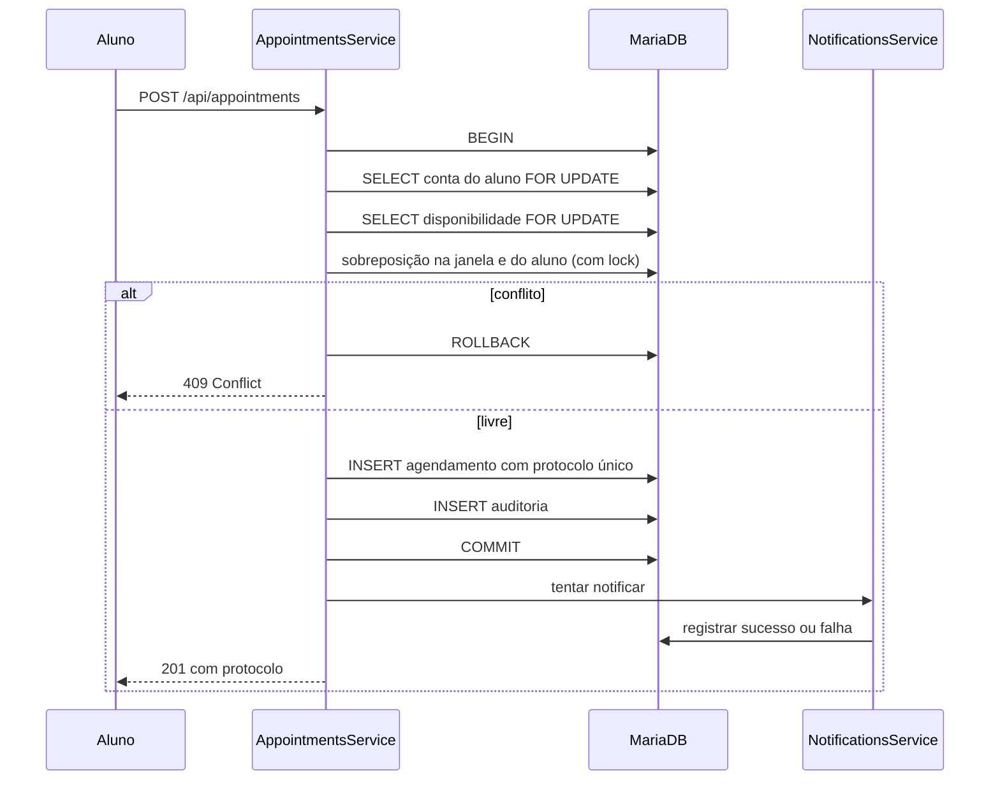

# Dossiê para o artigo

## Estado

Material de apoio para escrever o artigo sobre o sistema. Ele reúne, num só
lugar, o histórico datado do desenvolvimento, o cruzamento entre requisitos,
implementação, decisões e testes, os diagramas e o catálogo de figuras com o
procedimento para capturá-las.

Levantado em 31 de outubro de 2026 a partir do Git, das descrições dos Pull
Requests e da pasta `docs/`. Os horários estão no fuso de Porto Velho (UTC−4),
o mesmo dos commits. Os PRs #26 e #27 estavam abertos nessa data. O que depende
deles aparece marcado como **em revisão**.

Este documento não cria decisões. Pendências institucionais continuam em
`OPEN_QUESTIONS.md` e aparecem aqui apenas como limitações.

## 1. Como usar este dossiê

Roteiro sugerido para quem vai redigir o artigo em `.docx`:

1. Ler as seções 2 a 4 para montar introdução, objetivo e metodologia.
2. Usar a seção 5 (rastreabilidade) como base de "Desenvolvimento" ou
   "Resultados": cada linha liga um requisito ao PR, à data, à decisão, ao
   código, ao teste e à figura que o comprova.
3. Usar as seções 6 a 9 para arquitetura, modelo de dados, regras críticas e
   qualidade.
4. Usar a seção 10 para limitações e trabalhos futuros.
5. Capturar as figuras com a seção 12 e inseri-las conforme o catálogo da seção 11. Os diagramas Mermaid da seção 7 podem ser exportados como imagem (seção
   12.6).

Documentos de origem, para citação ou aprofundamento:

| Assunto                          | Arquivo                  |
| -------------------------------- | ------------------------ |
| Problema, atores e escopo        | `docs/PRODUCT_SCOPE.md`  |
| Requisitos `RF`, `RNF` e `RN`    | `docs/REQUIREMENTS.md`   |
| Arquitetura e módulos            | `docs/ARCHITECTURE.md`   |
| Entidades, estados e invariantes | `docs/DOMAIN_MODEL.md`   |
| Contrato da API                  | `docs/API_CONTRACT.md`   |
| Decisões (ADR-001 a ADR-032)     | `docs/DECISIONS.md`      |
| Pendências institucionais        | `docs/OPEN_QUESTIONS.md` |
| Fases e entregas                 | `docs/ROADMAP.md`        |
| Fluxo de branches e PRs          | `docs/GIT_WORKFLOW.md`   |
| Identidade visual                | `docs/DESIGN_SYSTEM.md`  |
| Ambiente publicado               | `docs/CLOUDFLARE.md`     |
| Backup e restauração             | `docs/BACKUP_RESTORE.md` |
| Dados e roteiro de demonstração  | `docs/DEMO.md`           |
| Protótipo visual inicial         | `docs/mockups/`          |

## 2. Ficha do projeto

| Item                  | Valor                                                                                 |
| --------------------- | ------------------------------------------------------------------------------------- |
| Nome                  | Sistema de Agendamento da coordenação de Ciência da Computação (`magrin-sac`)         |
| Problema              | Agendamento manual de atendimentos, conflitos de agenda e falta de indicadores        |
| Perfis                | Aluno, professor e administrador (coordenação)                                        |
| Arquitetura           | Monólito modular em monorepo (ADR-001)                                                |
| Frontend              | Vue 3, TypeScript, Vite, Tailwind CSS, Pinia, Vue Router, VeeValidate e Yup           |
| Backend               | Node.js 24, NestJS, TypeScript, API REST/JSON                                         |
| Persistência          | MariaDB, Sequelize 6, sequelize-typescript e migrations Umzug                         |
| Notificações          | Porta para WhatsApp (Twilio) isolada; integração real adiada (Fase 7)                 |
| Publicação            | Build da `main` em worktree isolada, exposta por Cloudflare Tunnel (ADR-023, ADR-024) |
| Gerenciador e runtime | pnpm 11 e Node.js 24 LTS                                                              |
| Qualidade             | ESLint, Prettier, `vue-tsc`, Vitest no frontend, `node:test` no backend               |
| Período registrado    | 29/08/2026 (documentos-fonte) a 31/10/2026 (último PR)                                |
| Autoria               | Matheus Endlich Vieira                                                                |

Números do código, medidos em 31/10/2026 na branch do PR #27:

| Métrica                                  | Valor                              |
| ---------------------------------------- | ---------------------------------- |
| Commits de trabalho (sem merges)         | 29                                 |
| Pull Requests                            | 27 (25 integrados, 2 em revisão)   |
| Promoções para a versão estável (`main`) | 5                                  |
| Decisões arquiteturais registradas       | 32 ADRs (2 superadas)              |
| Módulos de domínio no backend            | 10                                 |
| Models Sequelize (tabelas)               | 20                                 |
| Migrations versionadas                   | 28 (27 em `develop` + 1 no PR #27) |
| Endpoints REST                           | 43 (42 em `develop` + 1 no PR #27) |
| Views do frontend                        | 15                                 |
| Testes automatizados                     | 188 no backend e 126 no frontend   |
| Linhas em `frontend/src`                 | ≈ 19,5 mil                         |
| Linhas em `backend/src`                  | ≈ 13,7 mil                         |
| Linhas em `backend/test`                 | ≈ 5,5 mil                          |
| Linhas de documentação em `docs/`        | ≈ 7,4 mil                          |

As linhas foram contadas com `wc -l` sobre os arquivos versionados e incluem
comentários e linhas em branco.

## 3. Linha do tempo

### 3.1 Commits de trabalho

Cada PR foi integrado com um commit principal, de modo que a data do commit é a
data em que a funcionalidade ficou pronta. A coluna "PR" leva ao detalhe da
seção 3.2.

| Data e hora      | Commit    | PR  | Entrega                                                            |
| ---------------- | --------- | --- | ------------------------------------------------------------------ |
| 09/09/2026 21:24 | `99e69e0` | —   | Base documental e decisões iniciais                                |
| 27/09/2026 22:49 | `a3f903a` | —   | Backend NestJS com autenticação stateful                           |
| 28/09/2026 21:20 | `0e4dfcd` | —   | Login e identidade visual no frontend                              |
| 29/09/2026 22:24 | `822005f` | —   | Navegação por permissões e painel autenticado                      |
| 04/10/2026 01:39 | `6a9af55` | #1  | Gestão de usuários e agenda do professor                           |
| 04/10/2026 11:58 | `ffb2363` | #1  | Ambiente estável via Cloudflare Tunnel                             |
| 04/10/2026 12:00 | `6c626e3` | #1  | Instalação não interativa do worktree estável                      |
| 04/10/2026 12:10 | `b3d9dd0` | #1  | Frontend servido a partir do worktree estável                      |
| 04/10/2026 21:37 | `d274750` | #3  | Fluxo de branches e Pull Requests                                  |
| 07/10/2026 20:30 | `7f39f4c` | #4  | Fluxo inicial de agendamento do aluno                              |
| 15/10/2026 18:46 | `d87cc44` | #6  | Cancelamento auditável                                             |
| 15/10/2026 19:36 | `4b432ea` | #7  | Registro de atendimento                                            |
| 16/10/2026 18:53 | `95fd6b8` | #8  | Gestão de atendimentos e tratativas                                |
| 16/10/2026 19:05 | `1c6f2a8` | #9  | Dashboard de indicadores                                           |
| 22/10/2026 18:27 | `5fa1284` | #10 | Acessibilidade, responsividade e endurecimento para a demonstração |
| 26/10/2026 19:57 | `3b2547a` | #12 | Finais de linha e teste de data estável                            |
| 27/10/2026 18:09 | `957c3ad` | #13 | Página inicial com resumo por perfil                               |
| 27/10/2026 18:36 | `7be942e` | #15 | Bloqueio de horários do professor                                  |
| 27/10/2026 18:59 | `114a56d` | #16 | Trilha de auditoria administrativa                                 |
| 27/10/2026 19:33 | `4a2c5c4` | #17 | Matrícula do aluno                                                 |
| 27/10/2026 19:48 | `097f700` | #18 | Antecedência de cancelamento configurável                          |
| 27/10/2026 20:16 | `599da97` | #19 | Limite de login e proteção do último administrador                 |
| 28/10/2026 18:47 | `d8f2c46` | #20 | Tela de parâmetros do sistema                                      |
| 28/10/2026 19:27 | `143bdf4` | #21 | Correções da revisão geral dos fluxos no navegador                 |
| 28/10/2026 20:14 | `e37310c` | #22 | Dados de demonstração recriáveis                                   |
| 28/10/2026 20:40 | `ca9465d` | #23 | Menu tolerante a rotas inexistentes                                |
| 28/10/2026 20:51 | `013742c` | #24 | Novo layout dos horários livres                                    |
| 31/10/2026 15:08 | `c94ecb2` | #26 | Sem aviso de sessão inválida na primeira visita (em revisão)       |
| 31/10/2026 15:22 | `c699b18` | #27 | Bloqueio de tela por inatividade (em revisão)                      |

Os commits até 29/09 entraram em `develop` sem PR, antes da adoção do fluxo
descrito em `GIT_WORKFLOW.md` (PR #3).

### 3.2 Pull Requests

| PR  | Branch                                  | Aberto | Integrado   | Alteração      | Título                                        |
| --- | --------------------------------------- | ------ | ----------- | -------------- | --------------------------------------------- |
| #1  | `feat/admin-login-flow`                 | 04/10  | 04/10 13:21 | +18.618 / −353 | Gestão de usuários, agenda e ambiente estável |
| #3  | `docs/git-workflow`                     | 04/10  | 06/10 18:30 | +210 / −9      | Fluxo de branches e PRs                       |
| #4  | `feat/student-appointment-flow`         | 07/10  | 07/10 20:36 | +5.735 / −179  | Fluxo inicial de agendamentos                 |
| #6  | `feat/appointment-cancellation`         | 15/10  | 15/10 18:51 | +1.230 / −39   | Cancelamento auditável                        |
| #7  | `feat/attendance-registration`          | 15/10  | 15/10 19:37 | +1.871 / −42   | Registro de atendimentos                      |
| #8  | `feat/attendance-management`            | 16/10  | 16/10 18:55 | +2.552 / −34   | Gestão de atendimentos                        |
| #9  | `feat/attendance-dashboard`             | 16/10  | 16/10 19:06 | +736 / −26     | Dashboard de atendimentos                     |
| #10 | `fix/mvp-accessibility`                 | 22/10  | 22/10 18:30 | +952 / −39     | Preparação do MVP para demonstração           |
| #12 | `fix/line-endings-and-date-test`        | 26/10  | 27/10 18:10 | +16 / −1       | Finais de linha e data fixa no teste          |
| #13 | `feat/profile-home-dashboard`           | 27/10  | 27/10 18:10 | +621 / −245    | Index autenticada por perfil                  |
| #15 | `feat/availability-blocking`            | 27/10  | 27/10 18:37 | +615 / −44     | Bloqueio de horários                          |
| #16 | `feat/audit-trail`                      | 27/10  | 27/10 19:00 | +1.595 / −22   | Trilha de auditoria                           |
| #17 | `feat/student-registration-number`      | 27/10  | 27/10 19:34 | +436 / −35     | Matrícula do aluno                            |
| #18 | `feat/configurable-cancellation-notice` | 27/10  | 27/10 19:49 | +423 / −21     | Antecedência configurável                     |
| #19 | `fix/security-hardening`                | 27/10  | 27/10 20:17 | +518 / −72     | Endurecimento do login e último administrador |
| #20 | `feat/system-parameters-admin`          | 28/10  | 28/10 20:57 | +1.122 / −11   | Gestão de parâmetros                          |
| #21 | `fix/general-flow-review`               | 28/10  | 28/10 20:58 | +1.438 / −86   | Revisão geral dos fluxos                      |
| #22 | `feat/demo-seed`                        | 28/10  | 28/10 20:58 | +1.298 / −4    | Seed e roteiro de demonstração                |
| #23 | `fix/unknown-menu-route`                | 28/10  | 28/10 21:00 | +161 / −5      | Menu com rota inexistente                     |
| #24 | `fix/new-appointment-layout`            | 28/10  | 28/10 20:58 | +1.580 / −164  | Layout do novo agendamento                    |
| #26 | `fix/silent-initial-session-check`      | 31/10  | em revisão  | +95 / −21      | Aviso de sessão na primeira visita            |
| #27 | `feat/idle-session-lock`                | 31/10  | em revisão  | +919 / −46     | Bloqueio por inatividade                      |

Os números ausentes (#2, #5, #11, #14 e #25) são as promoções para a `main`,
listadas a seguir. As contagens de linhas vêm do GitHub e incluem dados
semeados e documentação. O PR #1, por exemplo, traz os catálogos de cursos e
matérias levantados das matrizes curriculares em `docs/pdf/`.

### 3.3 Versões estáveis publicadas

| Data e hora      | PR  | Conteúdo promovido de `develop` para `main`                                    |
| ---------------- | --- | ------------------------------------------------------------------------------ |
| 04/10/2026 13:26 | #2  | Gestão de usuários, agenda do professor e ambiente estável                     |
| 07/10/2026 20:39 | #5  | Fluxo inicial de agendamentos                                                  |
| 22/10/2026 18:45 | #11 | MVP completo: cancelamento, atendimento e dashboard                            |
| 27/10/2026 18:12 | #14 | Index por perfil e normalização de finais de linha                             |
| 28/10/2026 21:01 | #25 | Versão de demonstração: auditoria, parâmetros, segurança, seed e revisão geral |

A versão de 28/10 foi apresentada ao professor orientador e aprovada em
31/10/2026. Daí em diante, o foco passou a ser ajustes, sem novas
funcionalidades (PRs #26 e #27).

### 3.4 Fases do roteiro

| Fase (`ROADMAP.md`)               | Período       | PRs principais              | Situação em 31/10            |
| --------------------------------- | ------------- | --------------------------- | ---------------------------- |
| 0 — Alinhamento                   | 29/08 a 09/09 | —                           | Parcial (pendências abertas) |
| 1 — Scaffold e qualidade          | 09/09 a 28/09 | commits iniciais            | Concluída                    |
| 2 — Identidade e autorização      | 27/09 a 31/10 | #1, #13, #17, #19, #27      | Concluída no MVP             |
| 3 — Fluxo vertical de agendamento | 04/10 a 27/10 | #1, #4, #15                 | Concluída                    |
| 4 — Cancelamento e histórico      | 15/10         | #6                          | Concluída                    |
| 5 — Atendimento e demanda         | 15/10 a 16/10 | #7, #8                      | Concluída                    |
| 6 — Dashboard                     | 16/10         | #9                          | Concluída                    |
| 7 — WhatsApp                      | 07/10 (base)  | #4                          | Adiada: só a base isolada    |
| 8 — Endurecimento e apresentação  | 04/10 a 31/10 | #10, #16, #18–#24, #26, #27 | Em andamento                 |

```mermaid
gantt
  title Desenvolvimento do sistema de agendamento (2026)
  dateFormat YYYY-MM-DD
  axisFormat %d/%m
  section Alinhamento
  Documentos-fonte e base documental :done, 2026-08-29, 2026-09-09
  section Base
  Scaffold, autenticação e navegação :done, 2026-09-09, 2026-09-29
  section MVP
  Usuários, agenda e ambiente estável :done, 2026-09-30, 2026-10-04
  Agendamento do aluno :done, 2026-10-05, 2026-10-07
  Cancelamento :done, 2026-10-14, 2026-10-15
  Atendimento e tratativas :done, 2026-10-15, 2026-10-16
  Dashboard :done, 2026-10-16, 2026-10-16
  section Endurecimento
  Acessibilidade e segurança :done, 2026-10-20, 2026-10-22
  Auditoria, matrícula, parâmetros, limite de login :done, 2026-10-26, 2026-10-27
  Revisão geral, seed e layout :done, 2026-10-28, 2026-10-28
  section Pós-apresentação
  Ajustes de sessão (em revisão) :active, 2026-10-31, 2026-10-31
```

As barras do gráfico usam as datas dos commits. O início de cada barra é
aproximado quando o trabalho não deixou commit intermediário.

## 4. Metodologia de desenvolvimento

Pontos que o repositório comprova e que podem compor a metodologia:

- **Documentação antes do código.** Os requisitos vieram de três documentos
  fornecidos em 29/08/2026 (`docs/README.md`, seção "Fontes consolidadas"). O
  primeiro commit (09/09) contém só a base documental, com escopo, requisitos,
  modelo de domínio, contrato e as 11 primeiras ADRs.
- **Decisões registradas como ADR.** Cada decisão relevante tem contexto,
  motivo e consequência em `DECISIONS.md`. A troca de Flask/SQLAlchemy (ADR-003
  e ADR-004) por NestJS/Sequelize (ADR-012 e ADR-013), em 27/09, ficou
  registrada como decisão superada, sem apagar o histórico.
- **Pendências explícitas.** Regras sem definição institucional ficam em
  `OPEN_QUESTIONS.md` e não são implementadas por suposição. Exemplos: a fórmula
  do percentual de resolução e o limite de agendamentos por aluno.
- **Fluxo Git com branches curtas.** A partir de 04/10, toda alteração nasce de
  `develop` numa branch `feat/`, `fix/` ou `docs/`, entra por PR e só chega à
  `main` por PR de promoção (`GIT_WORKFLOW.md`).
- **Ambientes separados.** O desenvolvimento usa o banco
  `magrin_sac_development`. A versão estável roda a partir da `main` num
  worktree próprio (`.worktrees/stable`), com banco separado, e é publicada pelo
  Cloudflare Tunnel.
- **Documentação viva.** Cada PR atualiza os documentos afetados, como contrato,
  modelo de domínio e roadmap.
- **Verificação automatizada antes do PR.** `pnpm check` executa lint, checagem
  de tipos, testes e build. A contagem de testes de cada PR está na seção 9.
- **Revisão no navegador.** Em 28/10, todos os fluxos dos três perfis foram
  percorridos com Playwright, e as falhas encontradas foram corrigidas no PR
  #21.
- **Uso de assistentes de IA.** O repositório documenta o uso do Codex no VS
  Code (`docs/CODEX_VSCODE.md`, `docs/CODEX_TROUBLESHOOTING.md`). A partir de
  26/10/2026, os commits trazem coautoria do Claude (`Co-Authored-By`). Cabe ao
  autor decidir como declarar isso no artigo, conforme as regras da
  instituição.

## 5. Matriz de rastreabilidade

Cada linha liga um requisito do MVP (`REQUIREMENTS.md`) à sua implementação. Os
testes de backend estão em `backend/test/` e os de frontend em
`frontend/src/__tests__/`. As figuras estão catalogadas na seção 11.

### 5.1 Acesso, usuários e sessão

| Requisito                                              | Implementação                                                                  | PR e data                        | ADR     | Código principal                                                                         | Testes                                                                                       | Figura   |
| ------------------------------------------------------ | ------------------------------------------------------------------------------ | -------------------------------- | ------- | ---------------------------------------------------------------------------------------- | -------------------------------------------------------------------------------------------- | -------- |
| `RF01`–`RF03`, `RF06`: autenticar e distinguir perfis  | Login local, JWT em cookie `HttpOnly` e sessão stateful no banco               | `a3f903a` 27/09; `0e4dfcd` 28/09 | ADR-016 | `backend/src/modules/auth/`, `frontend/src/views/LoginView.vue`                          | `auth.service.test.mjs`, `jwt-session.service.test.mjs`, `LoginView.spec.ts`                 | F01, F02 |
| Senha protegida em trânsito                            | Envelope AES-GCM + RSA-OAEP; chave privada só no servidor                      | #1, 04/10                        | ADR-019 | `backend/src/helpers/credential-encryption/`, `frontend/src/services/`                   | `credential-encryption.test.mjs`, `credential-encryption.spec.ts`                            | —        |
| `RNF15`: hash seguro                                   | Argon2id                                                                       | #1, 04/10                        | ADR-016 | `backend/src/helpers/password/`                                                          | `users-details.test.mjs`                                                                     | —        |
| Navegação por permissões                               | Menus e permissões no banco; guard no backend e checagem de rota no frontend   | `822005f` 29/09; #21 28/10       | ADR-018 | `backend/src/modules/navigation/`, `backend/src/guards/`, `frontend/src/router/index.ts` | `permission.guard.test.mjs`, `navigation.service.test.mjs`, `navigation.spec.ts`             | F31      |
| `RF05`: cadastrar, editar, ativar e desativar usuários | Wizard em quatro etapas, listagem e edição com vínculos acadêmicos             | #1, 04/10                        | ADR-018 | `backend/src/modules/users/`, `frontend/src/views/administration/User*.vue`              | `create-user.dto.test.mjs`, `users-details.test.mjs`, `UsersView.spec.ts`                    | F25, F26 |
| Exclusão lógica de cadastro indevido                   | Confirmação da senha do administrador e preservação do histórico               | #1, 04/10                        | ADR-020 | `users.service.ts`                                                                       | `users-details.test.mjs`                                                                     | F25      |
| Troca obrigatória da senha temporária                  | Bloqueio das demais APIs até a troca                                           | #1, 04/10                        | ADR-016 | `auth.service.ts`, `LoginView.vue`                                                       | `auth.service.test.mjs`, `LoginView.spec.ts`                                                 | —        |
| `RF07`: matrícula do aluno                             | Numérica, única e com `CHECK` no banco                                         | #17, 27/10                       | —       | migration `20261028100000`, `users.service.ts`                                           | `registration-number-migration.test.mjs`                                                     | F26      |
| Sempre um administrador ativo                          | Travamento das linhas de administradores na transação                          | #19, 27/10                       | ADR-030 | `users.service.ts`                                                                       | `users-details.test.mjs`                                                                     | —        |
| `RNF21`, `RNF22`: tentativas suspeitas                 | Limite por conta + IP e por IP; eventos com pseudônimos HMAC                   | #10 22/10; #19 27/10             | ADR-030 | `backend/src/modules/auth/login-attempt.service.ts`                                      | `login-attempt.service.test.mjs`                                                             | —        |
| Sessão: inatividade e duração absoluta                 | Tela bloqueada após 30 min (parâmetro) e sessão de 8 h; desbloqueio pela senha | #27, 31/10 (em revisão)          | ADR-032 | `frontend/src/stores/session-lock.ts`, `SessionLockOverlay.vue`, `auth.service.ts`       | `session-lock.spec.ts`, `auth.service.test.mjs`                                              | F29      |
| `RNF18`: aluno vê só os próprios dados                 | Usuário derivado sempre da sessão; sem `studentId` no contrato                 | #4, 07/10                        | ADR-025 | `appointments.service.ts`                                                                | `appointments.service.test.mjs` ("aluno consulta somente os próprios próximos agendamentos") | F08      |

### 5.2 Disponibilidade

| Requisito                                      | Implementação                                                      | PR e data  | ADR              | Código principal                                                                         | Testes                                                                                            | Figura   |
| ---------------------------------------------- | ------------------------------------------------------------------ | ---------- | ---------------- | ---------------------------------------------------------------------------------------- | ------------------------------------------------------------------------------------------------- | -------- |
| `RF08`–`RF11`: publicar horários e modalidades | Publicação atômica em lote, geração semanal e calendário mensal    | #1, 04/10  | ADR-021, ADR-022 | `backend/src/modules/availability/`, `frontend/src/views/professor/AvailabilityView.vue` | `availability.service.test.mjs`, `availability.dto.test.mjs`, `ProfessorAvailabilityView.spec.ts` | F13, F15 |
| `RF13`: impedir conflito de disponibilidade    | Rejeição de sobreposição no lote e com registros existentes        | #1, 04/10  | ADR-007          | `availability.service.ts`                                                                | `availability.service.test.mjs` ("rejeita conflito persistido…")                                  | F15      |
| `RF12`: bloquear e desbloquear                 | Só janelas sem agendamento confirmado, com o mesmo lock da reserva | #15, 27/10 | ADR-021          | `availability.service.ts`                                                                | `availability-blocking.test.mjs`                                                                  | F14      |
| Timezone institucional                         | `America/Porto_Velho`, normalizado na persistência                 | #1, 04/10  | ADR-022          | `backend/src/helpers/institution-date-time/`                                             | `availability.service.test.mjs`                                                                   | —        |
| Visão global do administrador                  | Permissões `*.read.any` distintas das próprias                     | #4, 07/10  | ADR-025          | `admin-availability.controller.ts`, `ScheduleView.vue`                                   | `admin-global-schedule-data.test.mjs`, `AdministrationScheduleView.spec.ts`                       | F20      |

### 5.3 Agendamento

| Requisito                                              | Implementação                                                                | PR e data                        | ADR     | Código principal                                               | Testes                                                                                               | Figura   |
| ------------------------------------------------------ | ---------------------------------------------------------------------------- | -------------------------------- | ------- | -------------------------------------------------------------- | ---------------------------------------------------------------------------------------------------- | -------- |
| `RF14`–`RF16`: consultar só horários aptos             | Busca mensal por modalidade, apenas trechos livres                           | #4 07/10; layout #24 28/10       | ADR-025 | `availability-search.controller.ts`, `NewAppointmentView.vue`  | `NewAppointmentView.spec.ts`                                                                         | F04, F12 |
| `RF17`–`RF20`: dados do agendamento                    | Subintervalo, modalidade, assunto e informações complementares               | #4, 07/10                        | —       | `NewAppointmentView.vue`, `create-appointment.dto.ts`          | `appointment-validation.spec.ts`                                                                     | F05, F06 |
| `RF21`–`RF23`, `RN02`, `RN03`: revalidação e conflitos | Transação com locks da conta e da disponibilidade e consulta de sobreposição | #4, 07/10                        | ADR-007 | `appointments.service.ts` (linhas com `LOCK.UPDATE`)           | "duas confirmações concorrentes reservam o mesmo intervalo somente uma vez"; "rejeita sobreposição…" | F06      |
| `RF24`, `RN04`: protocolo único                        | Protocolo aleatório protegido por índice único                               | #4, 07/10                        | ADR-007 | `appointments.service.ts`, migration `20261006100000`          | `appointments-migration.test.mjs`                                                                    | F07      |
| `RF25`, `RF26`: próximos e histórico                   | Área do aluno com próximo compromisso, filtros e calendário                  | #4, 07/10                        | —       | `MyAppointmentsView.vue`                                       | `MyAppointmentsView.spec.ts`                                                                         | F08, F09 |
| `RF27`, `RF28`: cancelamento por aluno e professor     | Motivo obrigatório e antecedência mínima                                     | #6 15/10; configurável #18 27/10 | ADR-029 | `appointments.service.ts`, `AppointmentCancellationModal.vue`  | "aluno cancela o próprio agendamento…", `AppointmentCancellationModal.spec.ts`                       | F10      |
| `RF30`: cancelamento administrativo                    | Até o início, com motivo e senha do administrador                            | #6, 15/10                        | ADR-019 | `admin-appointments.controller.ts`                             | "administrador cancela dentro de duas horas somente após validar a própria senha"                    | F21      |
| `RNF42`: antecedência parametrizável                   | `APPOINTMENT_CANCELLATION_MIN_NOTICE_MINUTES` (120 min) e tela de parâmetros | #18 27/10; #20 28/10             | ADR-029 | `backend/src/helpers/system-parameters/`, `ParametersView.vue` | `system-parameters.service.test.mjs`, `parameters.service.test.mjs`, `ParametersView.spec.ts`        | F28      |

### 5.4 Atendimento e demanda

| Requisito                                            | Implementação                                                                | PR e data | ADR     | Código principal                                                     | Testes                                                               | Figura        |
| ---------------------------------------------------- | ---------------------------------------------------------------------------- | --------- | ------- | -------------------------------------------------------------------- | -------------------------------------------------------------------- | ------------- |
| `RF31`, `RF32`, `RN11`: realização ou ausência       | Registro após o início previsto, pelo professor responsável ou administrador | #7, 15/10 | ADR-026 | `backend/src/modules/attendance/`, `AttendanceRegistrationModal.vue` | `attendance.service.test.mjs`, `AttendanceRegistrationModal.spec.ts` | F16           |
| `RF33`, `RF37`, `RF38`, `RF43`: observações internas | Observações e encaminhamentos nunca expostos ao aluno                        | #7, 15/10 | ADR-026 | `attendance.service.ts`                                              | `attendance.service.test.mjs`                                        | F16, F23      |
| `RF34`–`RF36`, `RN07`–`RN09`: classificação          | Resolvido, não resolvido e em tratativa, com campos obrigatórios por estado  | #7, 15/10 | ADR-026 | `register-attendance.dto.ts`                                         | `attendance.dto.test.mjs`                                            | F16           |
| `RF39`: continuidade da tratativa                    | Responsável, próximo passo e prazo obrigatórios                              | #7, 15/10 | ADR-027 | `update-attendance-status.dto.ts`                                    | `attendance.dto.test.mjs`                                            | F24           |
| `RF40`–`RF42`: histórico e filtros                   | Histórico com ator e data, filtros por período, ocorrência e classificação   | #8, 16/10 | ADR-027 | `AttendancesView.vue`, `AttendanceDetailsView.vue`                   | `AttendancesView.spec.ts`, `AttendanceTransitionModal.spec.ts`       | F17, F22, F23 |
| Estados finais sem reabertura                        | Só `em_tratativa` aceita nova transição                                      | #8, 16/10 | ADR-027 | `attendance.service.ts`                                              | "ausência e classificação final não podem ser reabertas"             | F24           |

### 5.5 Indicadores

| Requisito                               | Implementação                                                                   | PR e data | ADR     | Código principal                                      | Testes                                                                                       | Figura   |
| --------------------------------------- | ------------------------------------------------------------------------------- | --------- | ------- | ----------------------------------------------------- | -------------------------------------------------------------------------------------------- | -------- |
| `RF44`–`RF47`: quatro totais            | Realizados, resolvidos, não resolvidos e em tratativa, calculados dos registros | #9, 16/10 | ADR-009 | `backend/src/modules/dashboard/`, `DashboardView.vue` | "calcula os quatro totais diretamente dos registros de atendimento", `DashboardView.spec.ts` | F19, F30 |
| `RF48`: filtro por período              | Período de até 366 dias                                                         | #9, 16/10 | ADR-009 | `dashboard-query.dto.ts`                              | "rejeita período invertido ou superior a 366 dias"                                           | F19      |
| `RF54`: rastrear registros do indicador | "Ver registros" abre a listagem filtrada                                        | #9, 16/10 | ADR-009 | `DashboardView.vue`                                   | `DashboardView.spec.ts`                                                                      | F19, F22 |
| `RN10`, `RN12`: cancelamento e ausência | Cancelados não contam como realizados; ausência sem classificação               | #7, #9    | ADR-026 | `dashboard.service.ts`                                | `dashboard.service.test.mjs`                                                                 | F19      |
| Escopo do professor                     | Totais restritos às próprias disponibilidades                                   | #9, 16/10 | ADR-025 | `professor-dashboard.controller.ts`                   | "restringe o resumo do professor às disponibilidades atribuídas"                             | —        |

### 5.6 Notificações, auditoria e operação

| Requisito                                | Implementação                                                                 | PR e data            | ADR              | Código principal                              | Testes                                                                                           | Figura        |
| ---------------------------------------- | ----------------------------------------------------------------------------- | -------------------- | ---------------- | --------------------------------------------- | ------------------------------------------------------------------------------------------------ | ------------- |
| Falha no WhatsApp não desfaz agendamento | Notificação após o commit; tentativa gravada com destino mascarado            | #4, 07/10            | ADR-005, ADR-006 | `backend/src/modules/notifications/`          | "falha de notificação não desfaz nem transforma a confirmação em erro", `notifications.test.mjs` | —             |
| `RF61`–`RF65`, `RNF26`: auditoria        | `audit_logs` somente de inserção, na mesma transação, sem valores sensíveis   | #16, 27/10           | ADR-028          | `backend/src/modules/audit/`, `AuditView.vue` | `audit.service.test.mjs`, `audit-migrations.test.mjs`, `AuditView.spec.ts`                       | F27           |
| `RNF44`–`RNF52`: acessibilidade          | Teclado, foco visível, rótulos e estados não dependentes de cor               | #10 22/10; #21 28/10 | —                | `frontend/src/components/basic/`              | `basic-components.spec.ts`                                                                       | F11, F12, F31 |
| `RNF01`–`RNF08`: responsividade          | Telas validadas em 320, 375, 768 e 1024 px                                    | #10 22/10; #24 28/10 | —                | `AppShell.vue`, `AppCalendar.vue`             | verificação manual registrada no PR #10                                                          | F11, F12, F31 |
| Identidade visual e temas                | Tokens semânticos com tema claro e escuro                                     | `0e4dfcd` 28/09      | ADR-015          | `frontend/src/assets/main.css`, `useTheme.ts` | `useTheme.spec.ts`                                                                               | F02, F30      |
| `RNF36`: instalação e operação           | README, backup e restauração, Cloudflare e demonstração                       | #1, #10, #22         | ADR-023, ADR-031 | `README.md`, `docs/`                          | —                                                                                                | —             |
| Ambiente de demonstração                 | Seed recriável com contas `@demo.test` e identidades inválidas por construção | #22, 28/10           | ADR-031          | `backend/src/database/database.demo-seed.ts`  | `database.demo-seed.test.mjs`                                                                    | todas         |

### 5.7 Critérios de aceite do primeiro fluxo vertical

| Critério (`REQUIREMENTS.md`)                                      | Situação                                                 | Evidência                                            |
| ----------------------------------------------------------------- | -------------------------------------------------------- | ---------------------------------------------------- |
| 1. Aluno consulta horários disponíveis                            | Atendido em 07/10 (#4)                                   | F04                                                  |
| 2. Aluno agenda e recebe protocolo                                | Atendido em 07/10 (#4)                                   | F06, F07                                             |
| 3. Duas solicitações concorrentes não reservam o mesmo horário    | Atendido em 07/10 (#4)                                   | teste concorrente em `appointments.service.test.mjs` |
| 4. Agenda administrativa exibe o compromisso                      | Atendido em 07/10 (#4)                                   | F20                                                  |
| 5. Registro de realização, ausência e resultado                   | Atendido em 15–16/10 (#7, #8)                            | F16, F23, F24                                        |
| 6. Quatro indicadores refletem os registros                       | Atendido em 16/10 (#9)                                   | F19                                                  |
| 7. Aluno não acessa dados de outro aluno nem observações internas | Atendido (#4, #7)                                        | testes de isolamento                                 |
| 8. Operações administrativas aparecem na auditoria                | Atendido em 27/10 (#16)                                  | F27                                                  |
| 9. Falha da Twilio não invalida o agendamento                     | Atendido com o provider indisponível; Twilio real adiada | teste de falha de notificação                        |
| 10. Fluxos em desktop e celular, com testes ou roteiro            | Atendido (#10, #22)                                      | F11, F12, F31; `docs/DEMO.md`                        |

## 6. Decisões arquiteturais datadas

A data é a do commit que registrou a decisão em `DECISIONS.md`.

| ADR | Data  | Decisão                                                  |
| --- | ----- | -------------------------------------------------------- |
| 001 | 09/09 | Monorepo com monólito modular                            |
| 002 | 09/09 | Vue 3 e TypeScript no frontend                           |
| 003 | 09/09 | Flask e REST/JSON no backend (superada pela 012)         |
| 004 | 09/09 | SQLAlchemy e migrations (superada pela 013)              |
| 005 | 09/09 | Twilio isolada no módulo de notificações                 |
| 006 | 09/09 | Notificação após a transação principal                   |
| 007 | 09/09 | Concorrência protegida no banco e no backend             |
| 008 | 09/09 | Histórico preservado                                     |
| 009 | 09/09 | Indicadores derivados dos registros                      |
| 010 | 09/09 | Node.js 24 no monorepo                                   |
| 011 | 09/09 | pnpm como gerenciador do workspace                       |
| 012 | 27/09 | Node.js 24, NestJS e TypeScript no backend               |
| 013 | 27/09 | Sequelize e Umzug no MariaDB                             |
| 014 | 27/09 | ESLint e Prettier                                        |
| 015 | 27/09 | Paleta institucional por tokens semânticos               |
| 016 | 27/09 | Autenticação local com JWT e sessão stateful             |
| 017 | 27/09 | Parâmetros operacionais separados de segredos            |
| 018 | 27/09 | Auditoria estrutural e identificadores numéricos         |
| 019 | 04/10 | Envelope híbrido para credenciais de senha               |
| 020 | 04/10 | Exclusão lógica de cadastro indevido                     |
| 021 | 04/10 | Agenda própria do professor                              |
| 022 | 04/10 | Formulário de disponibilidade e timezone                 |
| 023 | 04/10 | Publicação temporária por Cloudflare Tunnel              |
| 024 | 04/10 | `main` isolada como versão estável                       |
| 025 | 07/10 | Consulta global administrativa sem bypass de escopo      |
| 026 | 15/10 | Registro transacional de atendimento e ausência          |
| 027 | 16/10 | Evolução auditável da demanda sem reabertura             |
| 028 | 27/10 | Trilha de auditoria transacional e somente de inserção   |
| 029 | 27/10 | Parâmetros institucionais tipados com valor aprovado     |
| 030 | 27/10 | Limite de login por conta + IP e eventos pseudonimizados |
| 031 | 28/10 | Dados de demonstração recriáveis e isolados              |
| 032 | 31/10 | Bloqueio de tela por inatividade (em revisão, PR #27)    |

## 7. Arquitetura e modelo

### 7.1 Visão de componentes



Na publicação, o build da `main` roda num worktree isolado e o Cloudflare
Tunnel expõe o frontend e a API por HTTPS, sem abrir portas no computador
(ADR-023, ADR-024).

### 7.2 Modelo de dados simplificado



Há ainda `system_parameters`, `system_options`, `system_option_items` e
`integration_endpoints`. Os campos estão em `DOMAIN_MODEL.md` e nos models de
`backend/src/models/`.

### 7.3 Estados





O primeiro diagrama é o ciclo do agendamento. O segundo é o resultado da
demanda, que só existe para atendimento realizado. Resolvido e não resolvido são
finais no MVP (ADR-027).

### 7.4 Confirmação concorrente de agendamento



Uma falha de notificação não altera a resposta `201` (ADR-006). O teste
concorrente dispara duas confirmações ao mesmo tempo e verifica que só uma é
aceita.

## 8. Contrato da API

Todas as rotas usam o prefixo `/api`. O detalhe de cada uma está em
`API_CONTRACT.md`.

| Área            | Rotas                                                                                                                                                                                                                      |
| --------------- | -------------------------------------------------------------------------------------------------------------------------------------------------------------------------------------------------------------------------- |
| Sessão          | `GET auth/credential-key`, `POST auth/login`, `POST auth/logout`, `POST auth/first-access/password`, `GET me`, `GET me/session` (PR #27), `GET me/navigation`                                                              |
| Usuários        | `GET/POST admin/users`, `GET/PATCH/DELETE admin/users/:id`, `GET admin/users/registration-options`, `GET admin/users/registration-options/subjects`                                                                        |
| Disponibilidade | `GET/POST professor/availability`, `POST professor/availability/:id/block`, `POST professor/availability/:id/unblock`, `GET admin/availability`, `GET availability` (busca do aluno)                                       |
| Agendamento     | `POST appointments`, `GET appointments/mine`, `POST appointments/:id/cancel`, `GET professor/appointments`, `POST professor/appointments/:id/cancel`, `GET admin/appointments`, `POST admin/appointments/:id/cancel`       |
| Atendimento     | `GET professor/attendances`, `GET professor/attendances/:id`, `GET professor/attendances/:id/history`, `PUT professor/appointments/:id/attendance`, `PATCH professor/attendances/:id/status` e as equivalentes em `admin/` |
| Indicadores     | `GET admin/dashboard`, `GET professor/dashboard`                                                                                                                                                                           |
| Parâmetros      | `GET admin/system-parameters`, `PATCH admin/system-parameters/:name`                                                                                                                                                       |
| Auditoria       | `GET admin/audit-logs`                                                                                                                                                                                                     |
| Saúde           | `GET health`                                                                                                                                                                                                               |

## 9. Qualidade e testes

### 9.1 Evolução das suítes

Contagem informada na descrição de cada PR. PRs paralelos partiram de bases
diferentes, por isso a sequência não é estritamente crescente.

| PR  | Data  | Backend | Frontend |
| --- | ----- | ------- | -------- |
| #1  | 04/10 | 86      | 66       |
| #6  | 15/10 | 108     | 86       |
| #7  | 15/10 | 118     | 90       |
| #9  | 16/10 | 130     | 97       |
| #10 | 22/10 | 133     | 99       |
| #13 | 27/10 | —       | 100      |
| #15 | 27/10 | 140     | —        |
| #16 | 27/10 | 148     | 106      |
| #17 | 27/10 | 154     | 106      |
| #21 | 28/10 | 176     | 116      |
| #24 | 28/10 | 176     | 116      |
| #26 | 31/10 | 185     | 119      |
| #27 | 31/10 | 188     | 126      |

### 9.2 Cobertura do conjunto mínimo exigido

| Verificação exigida (`AGENTS.md`) | Teste                                                                                                                       |
| --------------------------------- | --------------------------------------------------------------------------------------------------------------------------- |
| 1. Concorrência                   | `appointments.service.test.mjs`: "duas confirmações concorrentes reservam o mesmo intervalo somente uma vez"                |
| 2. Autorização entre alunos       | `appointments.service.test.mjs`: "aluno consulta somente os próprios próximos agendamentos"; `permission.guard.test.mjs`    |
| 3. Conflito do aluno              | `appointments.service.test.mjs`: "rejeita sobreposição…" e "informa ao aluno quando a sobreposição é com a própria reserva" |
| 4. Falha de notificação           | `appointments.service.test.mjs`: "falha de notificação não desfaz nem transforma a confirmação em erro"                     |
| 5. Indicadores                    | `dashboard.service.test.mjs`; `attendance.service.test.mjs` (ausência sem classificação)                                    |
| 6. Auditoria                      | `audit.service.test.mjs`; `parameters.service.test.mjs` ("altera o valor na transação, trava a linha e audita com motivo")  |
| 7. Acessibilidade                 | `basic-components.spec.ts` e testes das views; revisão manual registrada no PR #10                                          |
| 8. Migrations reversíveis         | testes de `up` e `down` em `*-migration.test.mjs`, `*-schema.test.mjs` e `*-data.test.mjs`                                  |

### 9.3 Problemas encontrados e corrigidos

Material para uma seção de lições aprendidas. Todos foram encontrados na
revisão no navegador ou no uso do ambiente estável:

- **Acesso direto por URL a rota restrita** (PR #21): chamadas simultâneas ao
  carregamento do menu deixavam a checagem de permissão passar antes de os dados
  chegarem. Agora as chamadas compartilham a mesma requisição.
- **Horário escolhido sem destaque** (PR #24): a comparação por identidade
  falhava porque o estado reativo guarda um proxy, não o objeto original.
- **Menu em branco** (PR #23): uma migration de menu chegou ao banco antes do
  frontend que registra a rota. A barra lateral passou a ignorar rotas
  inexistentes.
- **Aviso de erro na primeira visita** (PR #26): o layout autenticado montava
  antes da primeira rota ser resolvida e consultava o menu sem sessão.
- **Sessão curta interrompendo o trabalho** (PR #27): virou bloqueio de tela com
  desbloqueio pela senha, decidido após a apresentação.
- **Testes dependentes da data** (PRs #12 e #26): os relógios foram congelados ou
  as datas passaram a ser relativas ao dia da execução.

## 10. Limitações e trabalhos futuros

Pendências de `OPEN_QUESTIONS.md` e itens abertos do `ROADMAP.md` em 31/10/2026:

- integração real com a Twilio, lembretes e reenvio de notificações (Fase 7);
- fórmula do percentual de resolução, que depende do denominador (`RF55`);
- limite de agendamentos futuros por aluno;
- antecedência mínima e janela máxima de agendamento; bloqueio parcial de janelas
  com reservas;
- alteração administrativa de data e horário (`RF29`);
- recuperação de senha (`RF04`) e autocadastro de aluno com validação
  institucional;
- diferença entre coordenador e usuário administrativo;
- categorias oficiais de atendimento;
- grade curricular versionada e histórico acadêmico;
- formato oficial da matrícula;
- local e link do atendimento presencial ou online;
- política de LGPD, retenção, backup e primeiro teste integral de restauração;
- observabilidade mínima e hospedagem definitiva;
- relatórios e exportação.

## 11. Catálogo de figuras

Todas as telas usam somente dados fictícios do seed de demonstração (ADR-031):
contas `@demo.test`, CPFs com dígito verificador inválido e telefones
reservados. Não capture telas com contas reais.

Contas usadas, todas com a senha definida em `DEMO_SEED_PASSWORD`:

| Perfil        | Conta                                                       |
| ------------- | ----------------------------------------------------------- |
| Administrador | `coordenacao@demo.test`                                     |
| Professor     | `helena.duarte@demo.test` (horário bloqueado)               |
| Professor     | `ricardo.lima@demo.test` (atendimento pendente de registro) |
| Aluno         | `ana.souza@demo.test`                                       |

| ID  | Arquivo                                   | Conta       | Rota                                    | Estado capturado                       | Legenda sugerida                     | Seção do artigo           |
| --- | ----------------------------------------- | ----------- | --------------------------------------- | -------------------------------------- | ------------------------------------ | ------------------------- |
| F01 | `F01-login.png`                           | —           | `/login`                                | Página inicial                         | Tela de acesso ao sistema            | Interface                 |
| F02 | `F02-login-escuro.png`                    | —           | `/login`                                | Tema escuro                            | Tela de acesso no tema escuro        | Identidade visual         |
| F03 | `F03-aluno-inicio.png`                    | Ana         | `/`                                     | Próximo compromisso e atalhos          | Página inicial do aluno              | Fluxo do aluno            |
| F04 | `F04-aluno-horarios-livres.png`           | Ana         | `/agendamentos/novo`                    | Dia com horários livres selecionado    | Consulta de horários livres          | Agendamento               |
| F05 | `F05-aluno-formulario-agendamento.png`    | Ana         | `/agendamentos/novo`                    | Horário escolhido e assunto preenchido | Formulário do agendamento            | Agendamento               |
| F06 | `F06-aluno-revisao.png`                   | Ana         | `/agendamentos/novo`                    | Modal "Revise seu agendamento"         | Revisão antes da confirmação         | Agendamento               |
| F07 | `F07-aluno-protocolo.png`                 | Ana         | `/agendamentos/novo`                    | Confirmação com protocolo (opcional)   | Agendamento confirmado com protocolo | Agendamento               |
| F08 | `F08-aluno-meus-agendamentos.png`         | Ana         | `/agendamentos/meus`                    | Próximo compromisso e histórico        | Agendamentos do aluno                | Fluxo do aluno            |
| F09 | `F09-aluno-detalhes.png`                  | Ana         | `/agendamentos/meus`                    | Modal de detalhes                      | Detalhes do agendamento              | Fluxo do aluno            |
| F10 | `F10-aluno-cancelamento.png`              | Ana         | `/agendamentos/meus`                    | Modal de cancelamento                  | Cancelamento com motivo e prazo      | Cancelamento              |
| F11 | `F11-aluno-inicio-celular.png`            | Ana         | `/`                                     | 375 × 812 px                           | Página inicial no celular            | Responsividade            |
| F12 | `F12-aluno-novo-agendamento-celular.png`  | Ana         | `/agendamentos/novo`                    | 375 × 812 px                           | Novo agendamento no celular          | Responsividade            |
| F13 | `F13-professor-agenda.png`                | Helena      | `/professor/agenda`                     | Calendário e totais                    | Agenda mensal do professor           | Disponibilidade           |
| F14 | `F14-professor-horario-bloqueado.png`     | Helena      | `/professor/agenda`                     | Dia com horário bloqueado              | Bloqueio de horário                  | Disponibilidade           |
| F15 | `F15-professor-publicar-horarios.png`     | Helena      | `/professor/agenda`                     | Modal "Adicionar horários"             | Publicação de disponibilidades       | Disponibilidade           |
| F16 | `F16-professor-registrar-atendimento.png` | Ricardo     | `/professor/agenda`                     | Modal "Registrar atendimento"          | Registro do atendimento              | Atendimento               |
| F17 | `F17-professor-atendimentos.png`          | Ricardo     | `/professor/atendimentos`               | Lista com filtros                      | Atendimentos do professor            | Atendimento               |
| F18 | `F18-admin-inicio.png`                    | Coordenação | `/`                                     | Resumo do administrador                | Página inicial da coordenação        | Fluxo da coordenação      |
| F19 | `F19-admin-dashboard.png`                 | Coordenação | `/relatorios/dashboard`                 | Quatro indicadores                     | Dashboard de atendimentos            | Indicadores               |
| F20 | `F20-admin-agenda-geral.png`              | Coordenação | `/administracao/agenda`                 | Agenda de todos os professores         | Agenda geral                         | Fluxo da coordenação      |
| F21 | `F21-admin-cancelamento-senha.png`        | Coordenação | `/administracao/agenda`                 | Modal de cancelamento com senha        | Cancelamento administrativo          | Cancelamento e segurança  |
| F22 | `F22-admin-atendimentos.png`              | Coordenação | `/administracao/atendimentos`           | Lista com filtros e resumo             | Gestão de atendimentos               | Atendimento               |
| F23 | `F23-admin-atendimento-tratativa.png`     | Coordenação | `/administracao/atendimentos/:id`       | Demanda em tratativa e histórico       | Detalhe de demanda em tratativa      | Atendimento               |
| F24 | `F24-admin-atualizar-tratativa.png`       | Coordenação | `/administracao/atendimentos/:id`       | Modal "Atualizar tratativa"            | Evolução da tratativa                | Atendimento               |
| F25 | `F25-admin-usuarios.png`                  | Coordenação | `/administracao/usuarios`               | Listagem com busca e filtros           | Gestão de usuários                   | Administração             |
| F26 | `F26-admin-cadastro-usuario.png`          | Coordenação | `/administracao/usuarios/novo`          | Primeira etapa do cadastro             | Cadastro de usuário em etapas        | Administração             |
| F27 | `F27-admin-auditoria.png`                 | Coordenação | `/administracao/auditoria`              | Trilha do período                      | Trilha de auditoria                  | Segurança e auditoria     |
| F28 | `F28-admin-parametros.png`                | Coordenação | `/administracao/parametros`             | Parâmetros e formulário                | Parâmetros institucionais            | Administração             |
| F29 | `F29-bloqueio-inatividade.png`            | Coordenação | `/`                                     | Tela bloqueada após 31 min simulados   | Bloqueio por inatividade             | Segurança (requer PR #27) |
| F30 | `F30-admin-dashboard-escuro.png`          | Coordenação | `/relatorios/dashboard`                 | Tema escuro                            | Dashboard no tema escuro             | Identidade visual         |
| F31 | `F31-menu-celular.png`                    | Coordenação | `/`                                     | 375 px com menu aberto                 | Navegação no celular                 | Responsividade            |
| F32 | `F32-prototipo-inicial.png`               | —           | `docs/mockups/sistema-agendamento.html` | Protótipo estático                     | Protótipo visual inicial             | Metodologia               |

Sugestão de conjunto enxuto, se o artigo tiver limite de figuras: F01, F04, F06,
F13, F16, F19, F23 e F27.

Os diagramas da seção 7 também podem virar figuras: componentes (7.1), modelo
de dados (7.2), estados (7.3), confirmação concorrente (7.4) e linha do tempo
(gráfico de Gantt da seção 3.4).

## 12. Como capturar as figuras

O script `scripts/capture-article-screenshots.mjs` faz login com cada conta,
percorre as telas da seção 11, abre os modais e salva as imagens. Ele foi
validado em 31/10/2026 no ambiente de desenvolvimento: as 31 capturas padrão
funcionaram, sendo a F29 com o código do PR #27.

### 12.1 Preparar o ambiente

1. Banco e `.env` configurados conforme o `README.md` da raiz. Migrations
   aplicadas:

   ```bash
   pnpm --filter backend db:migrate
   ```

2. Recriar os dados de demonstração. As datas são relativas ao dia, então rode
   no mesmo dia da captura, antes das 19h59 de Porto Velho, para existir o
   compromisso de hoje:

   ```bash
   DEMO_SEED_ENABLED=true DEMO_SEED_PASSWORD='<senha forte>' pnpm --filter backend db:seed:demo
   ```

   O comando roda `nest build`, que recria `backend/dist`. Se o backend em modo
   de desenvolvimento estiver aberto, reinicie-o depois do seed.

3. Subir backend e frontend, cada um num terminal:

   ```bash
   pnpm start:dev
   ```

   ```bash
   pnpm dev
   ```

   O frontend fica em `http://localhost:5173`. Também é possível capturar da
   versão estável (`pnpm stable`), apontando `CAPTURE_BASE_URL` para ela.

### 12.2 Instalar o Playwright fora do workspace

O Playwright não é dependência do projeto. Instale-o numa pasta separada para
não alterar `pnpm-lock.yaml`:

```bash
mkdir -p ../magrin-sac-captura && cd ../magrin-sac-captura && npm init -y && npm install playwright && npx playwright install chromium
```

Para usar o Chrome ou o Edge já instalados em vez de baixar o Chromium, pule o
`npx playwright install` e defina `CAPTURE_CHANNEL=chrome` ou
`CAPTURE_CHANNEL=msedge`.

### 12.3 Executar

Na raiz do repositório, em Bash:

```bash
CAPTURE_PASSWORD='<senha do seed>' PLAYWRIGHT_DIR=../magrin-sac-captura node scripts/capture-article-screenshots.mjs
```

No PowerShell:

```powershell
$env:CAPTURE_PASSWORD = '<senha do seed>'; $env:PLAYWRIGHT_DIR = '..\magrin-sac-captura'; node scripts/capture-article-screenshots.mjs
```

Variáveis disponíveis:

| Variável           | Uso                                               | Padrão                                     |
| ------------------ | ------------------------------------------------- | ------------------------------------------ |
| `CAPTURE_PASSWORD` | Senha das contas `@demo.test`                     | `DEMO_SEED_PASSWORD`                       |
| `CAPTURE_BASE_URL` | Endereço do frontend                              | `http://localhost:5173`                    |
| `CAPTURE_OUTPUT`   | Pasta das imagens                                 | `.article-screenshots` (ignorada pelo Git) |
| `CAPTURE_ONLY`     | Capturar só alguns ids, como `F04,F19`            | todas                                      |
| `CAPTURE_CONFIRM`  | `1` confirma um agendamento real para gerar a F07 | desligado                                  |
| `CAPTURE_CHANNEL`  | `chrome` ou `msedge`                              | Chromium do Playwright                     |
| `PLAYWRIGHT_DIR`   | Pasta em que o `playwright` foi instalado         | diretório atual                            |

### 12.4 Resultado

- As imagens ficam em `.article-screenshots/`, com os nomes da seção 11.
- `manifest.json` lista cada captura com `ok` ou `falhou` e o motivo. O script
  termina com código 1 se alguma falhar.
- As telas são de 1440 × 900 px (página inteira) e 375 × 812 px nas versões de
  celular. Os modais são capturados na área visível.
- O botão flutuante do Vue Devtools, presente só em desenvolvimento, é ocultado.

Casos especiais:

- **F07** altera o banco: cria um agendamento real para a Ana. Rode o seed de
  novo depois se quiser voltar ao estado inicial.
- **F29** só funciona com o PR #27 integrado. Em código sem o bloqueio, ela
  aparece como `falhou` no manifesto, e as outras não são afetadas. O script
  adianta o relógio do navegador em 31 minutos, sem esperar.
- Se uma tela mudar e o script não encontrar um elemento, a coluna "Estado
  capturado" da seção 11 descreve o que mostrar para capturar à mão.

### 12.5 Inserir no `.docx`

- Numere as figuras na ordem em que aparecem no texto, não pelo id do catálogo.
- Use a legenda sugerida e indique a fonte, por exemplo: "Figura 3 — Consulta de
  horários livres. Fonte: elaborado pelo autor (2026)."
- Para páginas longas capturadas inteiras, recorte a área relevante antes de
  inserir, ou prefira a captura do modal correspondente.
- Para o mesmo fluxo no computador e no celular, coloque as figuras lado a lado.

### 12.6 Exportar os diagramas Mermaid

Copie cada bloco `mermaid` da seção 7 (e o Gantt da seção 3.4) para um arquivo
`.mmd` e gere a imagem com o Mermaid CLI, também fora do workspace:

```bash
npx -y @mermaid-js/mermaid-cli -i diagrama.mmd -o diagrama.png -b white -s 2
```

Outra opção é colar o bloco em <https://mermaid.live> e exportar em PNG ou SVG.
