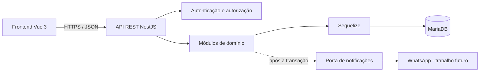
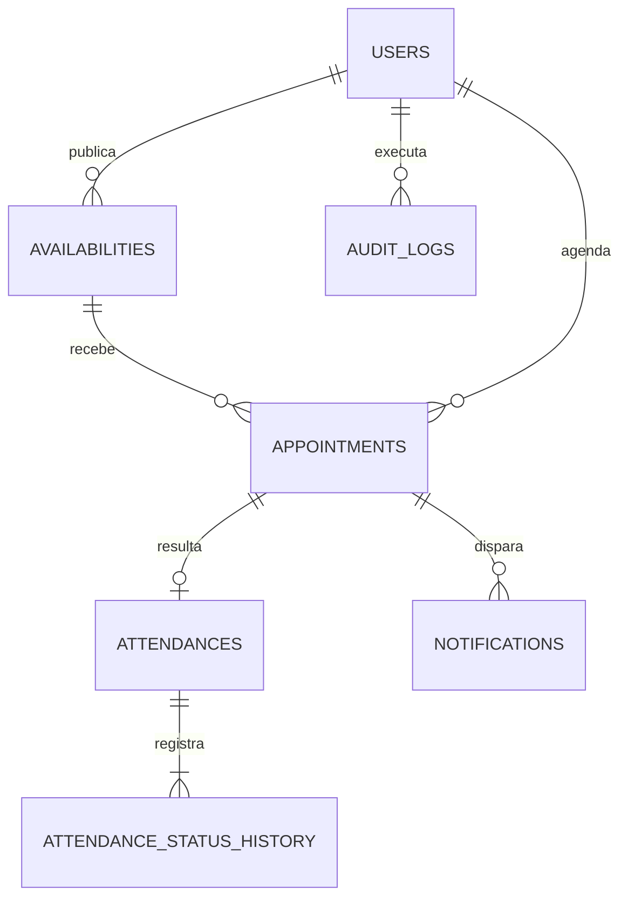
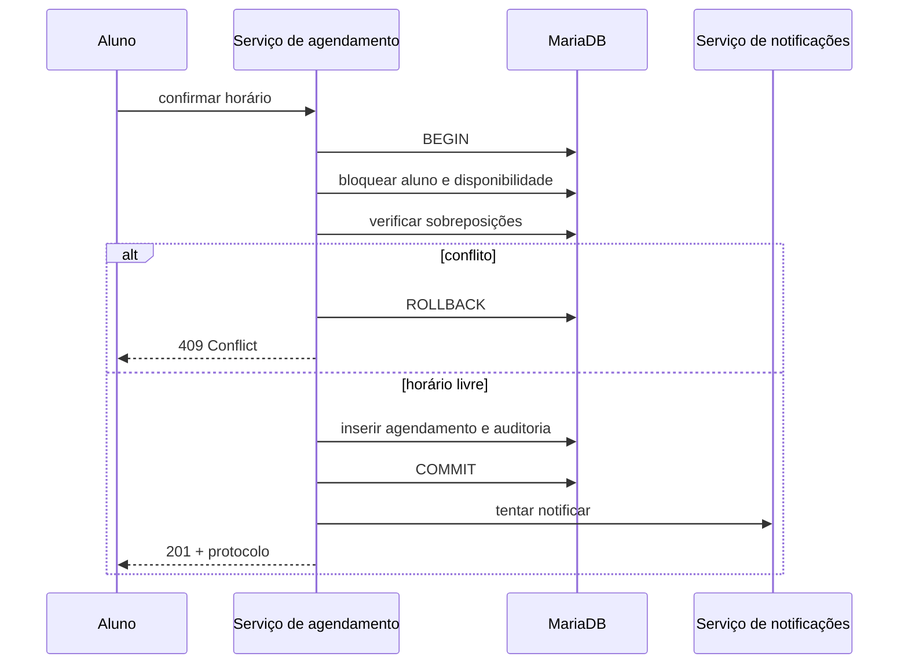

# Desenvolvimento de um sistema web para o agendamento de atendimentos acadêmicos

> **Rascunho inicial do artigo.** Texto elaborado a partir do estado documentado
> do projeto em 31 de outubro de 2026. Antes da submissão, preencher instituição,
> curso, orientador, coautores e regras do template; complementar a fundamentação
> bibliográfica conforme as normas adotadas pela instituição.

**Autor:** Matheus Endlich Vieira  
**Instituição:** [preencher]  
**Curso:** Ciência da Computação  
**Orientador(a):** [preencher]

## Resumo

O agendamento manual de atendimentos acadêmicos pode provocar conflitos de
horário, dispersão de informações e dificuldade para acompanhar os resultados
das demandas apresentadas pelos estudantes. Este trabalho descreve o
desenvolvimento de um sistema web para centralizar o fluxo de atendimento da
coordenação de um curso de Ciência da Computação, desde a publicação das
disponibilidades até o registro do resultado e a consolidação de indicadores.
Foi adotado um processo incremental orientado por documentação, com requisitos
rastreáveis, decisões arquiteturais registradas e validação contínua por testes
automatizados e revisão dos fluxos no navegador. A solução foi implementada
como um monólito modular em um monorepositório, com frontend em Vue 3 e
TypeScript, API REST em NestJS e persistência em MariaDB por meio do Sequelize.
Entre as regras críticas tratadas estão a prevenção de dupla reserva, a
revalidação da disponibilidade dentro de transação, o isolamento dos dados de
cada aluno, a preservação do histórico e a auditoria das operações
administrativas. O produto resultante contempla os fluxos de aluno, professor e
administrador, incluindo agenda, cancelamento, registro de atendimento,
acompanhamento de demandas e quatro indicadores operacionais. Os testes e a
rastreabilidade obtidos indicam que o fluxo vertical principal foi atendido. A
integração real com o WhatsApp e definições institucionais ainda pendentes foram
mantidas como trabalhos futuros para não transformar hipóteses em regras de
negócio.

**Palavras-chave:** agendamento acadêmico; sistema web; arquitetura modular;
concorrência; rastreabilidade.

## Abstract

Manual scheduling of academic support meetings can lead to time conflicts,
scattered information, and difficulty in tracking the outcomes of student
requests. This paper describes the development of a web system that centralizes
the support workflow of a Computer Science program, from publishing available
time slots to recording outcomes and consolidating indicators. An incremental,
documentation-driven process was adopted, with traceable requirements,
recorded architectural decisions, automated tests, and browser-based workflow
reviews. The solution was implemented as a modular monolith in a monorepository,
using Vue 3 and TypeScript for the frontend, a NestJS REST API, and MariaDB with
Sequelize for persistence. Critical rules include preventing double booking,
revalidating availability within a transaction, isolating each student's data,
preserving history, and auditing administrative operations. The resulting
product supports student, professor, and administrator workflows, including
schedules, cancellations, attendance records, request tracking, and four
operational indicators. Test results and traceability evidence indicate that
the main vertical workflow was completed. Real WhatsApp integration and
institutional definitions that remain open were intentionally left as future
work to avoid turning assumptions into business rules.

**Keywords:** academic scheduling; web system; modular architecture;
concurrency; traceability.

## 1 Introdução

O atendimento entre estudantes e a coordenação de um curso envolve atividades
que ultrapassam a simples escolha de uma data. É necessário disponibilizar
horários, impedir conflitos, identificar o responsável, registrar o assunto,
acompanhar o comparecimento, documentar encaminhamentos e consolidar os
resultados. Quando esse processo ocorre por mensagens ou registros dispersos,
a confirmação depende de conferência manual, o histórico torna-se difícil de
consultar e a gestão perde visibilidade sobre as demandas recorrentes.

O problema abordado neste trabalho surgiu da necessidade de centralizar o
agendamento dos atendimentos da coordenação do curso de Ciência da Computação.
O sistema deveria atender a três perfis principais. O aluno precisaria consultar
horários livres, confirmar uma reserva e acompanhar seus próprios compromissos.
O professor deveria publicar disponibilidades e registrar a realização ou a
ausência. Já a administração precisaria de visão global, instrumentos de
auditoria e indicadores derivados dos atendimentos efetivamente registrados.

O objetivo geral foi desenvolver um sistema web capaz de organizar o fluxo
completo do atendimento acadêmico, preservando segurança, histórico e
consistência dos dados. Como objetivos específicos, buscou-se:

- implementar autenticação e autorização por perfil e permissão;
- permitir a publicação e o bloqueio de disponibilidades;
- confirmar agendamentos de forma concorrente e transacional;
- oferecer cancelamento auditável conforme as regras institucionais;
- registrar atendimento, ausência, resultado e continuidade da demanda;
- apresentar indicadores calculados a partir dos registros operacionais;
- manter requisitos, decisões, implementação e testes rastreáveis.

O escopo concentrou-se no fluxo vertical mínimo do produto. Integrações
acadêmicas externas, relatórios avançados, múltiplos canais de notificação e
hospedagem definitiva não fizeram parte desta etapa. Essa delimitação permitiu
priorizar as regras que afetam diretamente a integridade do agendamento e a
privacidade dos usuários.

**Figura sugerida:** F01 — Tela de acesso ao sistema.

## 2 Fundamentação teórica

> Seção redigida como esqueleto. As referências sugeridas estão no fim do texto
> e devem ser conferidas (edição, ano e páginas) antes de entrar no `.docx`.
> Ampliar com a literatura indicada pelo orientador.

### 2.1 Requisitos e desenvolvimento incremental

A engenharia de requisitos trata da identificação, documentação e validação do
que um sistema deve fazer e das restrições sob as quais deve operar
(SOMMERVILLE, 2011). No desenvolvimento incremental, o sistema é construído em
partes sucessivas, cada uma entregando funcionalidade utilizável e permitindo
incorporar o retorno obtido nas etapas anteriores (SOMMERVILLE, 2011; PRESSMAN;
MAXIM, 2016). Neste trabalho, os requisitos foram numerados e relacionados à
implementação e aos testes, o que permite rastrear cada funcionalidade até sua
origem.

### 2.2 Registro de decisões arquiteturais

Os _Architecture Decision Records_ (ADRs) são documentos curtos que registram o
contexto, a decisão tomada e suas consequências, preservando a justificativa
das escolhas ao longo da evolução do sistema (NYGARD, 2011). Uma decisão
superada não é apagada: um novo registro a substitui, mantendo o histórico.

### 2.3 Arquitetura de aplicações web

A organização em camadas separa apresentação, regras de negócio e acesso a
dados, reduzindo o acoplamento entre essas responsabilidades (FOWLER, 2002). A
comunicação entre o cliente e o servidor seguiu o estilo arquitetural REST
(FIELDING, 2000), com recursos expostos por HTTP e representações em JSON. Um
monólito modular mantém a implantação em uma única unidade, mas divide o código
em módulos com fronteiras explícitas; essa abordagem evita a complexidade
operacional de serviços distribuídos em sistemas cujo domínio ainda está em
consolidação (FOWLER, 2015).

### 2.4 Transações e controle de concorrência

Uma transação agrupa operações que devem ser aplicadas integralmente ou não ser
aplicadas, preservando a consistência do banco de dados mesmo diante de falhas
ou execuções simultâneas (GRAY; REUTER, 1993). Quando duas requisições disputam
o mesmo recurso, uma verificação feita antes da escrita não basta, porque ambas
podem observar o mesmo estado. O bloqueio pessimista, como o `SELECT … FOR
UPDATE` do MariaDB, serializa o acesso à linha disputada até o fim da transação
(MARIADB, [2025]).

### 2.5 Segurança, privacidade e acessibilidade

O _Application Security Verification Standard_ (ASVS) reúne requisitos de
verificação para autenticação, gerenciamento de sessão, controle de acesso e
proteção de dados em aplicações web (OWASP, 2025). Para o armazenamento de
senhas, o Argon2 foi projetado para resistir a ataques de força bruta com uso
intensivo de memória (BIRYUKOV _et al._, 2021). No Brasil, o
tratamento de dados pessoais é regido pela Lei Geral de Proteção de Dados
(BRASIL, 2018). Quanto à interface, as Diretrizes de Acessibilidade para
Conteúdo Web orientam requisitos como navegação por teclado, foco visível e
alternativas textuais (W3C, 2024).

### 2.6 Trabalhos relacionados

> **A completar.** Descrever dois ou três sistemas ou estudos de agendamento
> acadêmico (soluções institucionais, ferramentas genéricas como agendas
> compartilhadas, ou trabalhos de conclusão semelhantes) e comparar com este
> projeto. Critérios sugeridos para a comparação: proteção contra dupla reserva,
> registro do resultado do atendimento, indicadores e auditoria. Não foram
> incluídos exemplos aqui para não citar trabalhos sem verificação.

## 3 Metodologia

Trata-se de uma pesquisa aplicada com desenvolvimento tecnológico, voltada à
solução de um problema concreto da coordenação do curso. A avaliação combinou
testes automatizados, revisão dos fluxos no navegador e apresentação da versão
estável ao professor orientador. _[Confirmar a classificação com o orientador.
Não chamar de estudo de caso sem descrever um método de coleta e análise de
dados.]_

O desenvolvimento adotou uma abordagem incremental orientada por documentação.
O trabalho começou pela consolidação do problema, dos atores, dos requisitos e
das pendências institucionais. Antes do primeiro scaffold executável, o
repositório já possuía documentos de escopo, arquitetura, modelo de domínio,
contrato inicial da API e decisões arquiteturais. Esse procedimento reduziu o
risco de incorporar ao código interpretações ainda não aprovadas.

As decisões relevantes foram registradas como _Architecture Decision Records_
(ADRs), com contexto, escolha e consequências. O histórico foi preservado mesmo
quando uma decisão foi superada. Foi o caso da substituição da proposta inicial
de Flask e SQLAlchemy por Node.js, NestJS, Sequelize e Umzug. Assim, o artigo e
o código podem ser relacionados à justificativa existente no momento de cada
mudança.

Após a criação dos scaffolds, as funcionalidades foram organizadas em etapas:
identidade e autorização; fluxo de disponibilidade e agendamento; cancelamento;
registro de atendimento; evolução da demanda; dashboard; e endurecimento para
demonstração. A partir da formalização do fluxo Git, cada alteração foi
desenvolvida em uma branch curta, revisada em Pull Request para `develop` e
promovida para `main` somente quando compunha uma versão estável. O ambiente de
demonstração da `main` foi isolado em um worktree próprio, com banco separado do
desenvolvimento.

A qualidade foi verificada em quatro níveis complementares:

1. lint e formatação automática para padronização do código;
2. checagem estática de tipos no frontend;
3. testes automatizados de serviços, migrations, autorização e componentes;
4. revisão manual dos fluxos dos três perfis em navegador.

Os dados empregados nas demonstrações são fictícios e recriáveis. As contas
utilizam o domínio reservado `@demo.test`, CPFs deliberadamente inválidos e
telefones reservados, evitando que as figuras do trabalho exponham dados
pessoais. O uso de assistentes de inteligência artificial durante o
desenvolvimento deve ser declarado na versão final conforme a política da
instituição.

**Figura sugerida:** F32 — Protótipo visual inicial.

## 4 Desenvolvimento da solução

### 4.1 Arquitetura

A solução foi estruturada como um monólito modular em um único repositório. O
frontend, construído com Vue 3, TypeScript, Vite, Pinia e Vue Router, concentra
a interface, a navegação e o estado de apresentação. O backend, implementado em
NestJS e TypeScript, expõe uma API REST em JSON e concentra as regras de negócio
e autorização. A persistência utiliza MariaDB, Sequelize 6,
`sequelize-typescript` e migrations versionadas com Umzug.

Essa separação impede que o frontend seja tratado como fonte de verdade de
regras críticas. Os controllers recebem e validam a requisição HTTP, enquanto
os serviços de aplicação coordenam regras e transações. O acesso ao banco passa
pelo ORM, e a integração de notificações permanece atrás de uma porta própria.
Por essa razão, os módulos de agendamento não dependem diretamente da SDK de um
provedor de WhatsApp.

Na demonstração remota, o backend também serve o build da aplicação de página
única. O serviço permanece preso ao endereço de loopback e é exposto por HTTPS
por meio de um Cloudflare Tunnel, sem publicar diretamente a porta do banco de
dados.

### 4.2 Modelo de domínio

As entidades centrais são usuário, disponibilidade, agendamento e atendimento.
Um professor publica uma ou mais janelas de disponibilidade e define as
modalidades permitidas. Um aluno confirma um agendamento dentro de uma dessas
janelas. Quando o compromisso é realizado, o agendamento origina um registro de
atendimento, que recebe o resultado da demanda e, quando necessário, um
histórico de continuidade.

O modelo também contempla sessões de autenticação, permissões, itens de menu,
parâmetros do sistema, notificações e auditoria. Os indicadores não são
armazenados como contadores independentes: eles são calculados a partir dos
registros de atendimento. Essa escolha evita divergência entre o histórico e o
valor apresentado no dashboard.

### 4.3 Autenticação, autorização e auditoria

A autenticação é local e mantém uma sessão stateful revogável. O navegador
recebe um cookie `HttpOnly`, enquanto o backend valida a sessão e as permissões
em cada operação protegida. As proteções do Vue Router melhoram a experiência
de navegação, mas não substituem a autorização no servidor.

O aluno só pode consultar os próprios agendamentos e não recebe observações
internas da coordenação. Professores acessam os registros associados às suas
disponibilidades. O administrador possui visão global, mas operações sensíveis
continuam exigindo capacidades explícitas e autoria auditável. Cancelamentos
administrativos e alterações de parâmetros registram o responsável, a data e o
motivo.

As senhas são protegidas por Argon2id e nunca são armazenadas em texto puro. A
transmissão de credenciais utiliza HTTPS no ambiente publicado e um envelope
híbrido adicional entre o navegador e o servidor. Segredos permanecem em
variáveis de ambiente e não são versionados.

**Figura sugerida:** F27 — Trilha de auditoria administrativa.

### 4.4 Publicação de disponibilidades

O professor pode publicar janelas para uma data específica ou preparar várias
janelas para os dias selecionados de uma semana. Cada janela possui início,
término e uma ou mais modalidades permitidas. O backend valida a ordem dos
horários, o timezone institucional e a inexistência de sobreposição antes da
persistência. Horários ainda não reservados podem ser bloqueados e
desbloqueados pelo responsável.

A visualização mensal reúne as janelas em um calendário e apresenta os detalhes
do dia selecionado em um painel lateral. O mesmo componente foi adaptado para
telas menores, preservando a navegação por teclado, o foco visível e os estados
de carregamento, vazio e erro.

**Figuras sugeridas:** F13 — Agenda mensal do professor; F15 — Publicação de
disponibilidades.

### 4.5 Confirmação concorrente do agendamento

A prevenção de dupla reserva constitui a principal regra de consistência do
fluxo. Uma verificação apenas no frontend não seria suficiente, porque dois
alunos poderiam selecionar o mesmo horário antes de qualquer resposta do
servidor. Por isso, a confirmação é executada em transação e revalida tanto a
disponibilidade quanto os compromissos conflitantes do aluno.

No banco, a proteção é o bloqueio pessimista: dentro da transação, a linha do
aluno e a da disponibilidade são lidas com `SELECT … FOR UPDATE`, de modo que
uma segunda confirmação para a mesma janela aguarda o fim da primeira e, ao
revalidar, encontra o intervalo ocupado. Não existe uma restrição de unicidade
contra intervalos sobrepostos, porque a sobreposição de períodos não se expressa
por uma chave simples; a consistência depende dessa serialização e da
revalidação.

O protocolo é único e permite identificar a reserva sem expor dados pessoais na
URL. A tentativa de notificação ocorre somente depois do commit. Portanto, uma
falha no provedor de mensagens não desfaz um agendamento válido nem transforma
a confirmação em erro para o aluno.

**Figuras sugeridas:** F04 — Consulta de horários livres; F06 — Revisão antes
da confirmação; F07 — Confirmação com protocolo (captura opcional).

### 4.6 Cancelamento e registro do atendimento

Aluno e professor podem cancelar um agendamento confirmado quando a antecedência
configurada permite, sempre informando um motivo. O administrador também pode
cancelar, mas a operação exige confirmação adicional por senha. O histórico é
preservado: cancelamento e ausência não são tratados como atendimentos
resolvidos.

Depois do horário marcado, o professor registra se houve realização ou ausência.
Um atendimento realizado pode ser classificado como resolvido, não resolvido ou
em tratativa. Demandas em tratativa exigem informação mínima de continuidade e
podem receber novas evoluções até a resolução ou o encerramento sem solução. Os
estados finais não são reabertos no escopo do MVP.

**Figuras sugeridas:** F10 — Cancelamento pelo aluno; F16 — Registro do
atendimento; F23 — Detalhe de demanda em tratativa; F24 — Evolução da
tratativa.

### 4.7 Indicadores

O dashboard apresenta quatro totais: atendimentos realizados, resolvidos, não
resolvidos e em tratativa. Os dados podem ser filtrados por período. Para o
professor, o backend restringe o cálculo às próprias disponibilidades; para a
administração, considera o conjunto autorizado. A tela permite abrir os
registros que compõem cada número, favorecendo a conferência do resultado.

A taxa percentual de resolução não foi incluída porque o denominador ainda
depende de definição institucional. Manter apenas os totais aprovados evita
apresentar uma métrica aparentemente precisa com significado ainda ambíguo.

**Figura sugerida:** F19 — Dashboard de atendimentos.

## 5 Resultados e discussão

O fluxo vertical proposto foi implementado desde a publicação da
disponibilidade até a consolidação dos indicadores. O aluno consulta horários,
confirma uma reserva, recebe um protocolo e acompanha seus compromissos. O
professor mantém a agenda e registra o resultado. A administração possui visão
global, parâmetros operacionais e trilha de auditoria.

A matriz de rastreabilidade relaciona os requisitos do MVP aos Pull Requests,
às decisões arquiteturais, aos arquivos principais, aos testes e às figuras.
Entre os critérios cobertos estão a concorrência de duas confirmações sobre o
mesmo horário, o isolamento dos dados de alunos, o conflito de compromissos, a
independência entre notificação e transação, o cálculo dos indicadores, a
auditoria e a reversibilidade das migrations.

O teste de concorrência exige uma ressalva. Ele executa duas confirmações
simultâneas sobre o mesmo intervalo e verifica que apenas uma é aceita, mas
substitui o MariaDB por uma trava simulada que imita o bloqueio de linha.
Portanto, comprova a lógica do serviço — travar, revalidar e só então inserir —,
e não o comportamento do banco sob carga real, que permanece como verificação
pendente.

O Quadro 1 resume o volume do trabalho registrado no repositório até 31 de
outubro de 2026.

**Quadro 1** — Indicadores do desenvolvimento

| Indicador                                 | Valor                                     |
| ----------------------------------------- | ----------------------------------------- |
| Período                                   | 29/08/2026 (documentos) a 31/10/2026      |
| Commits de trabalho                       | 29                                        |
| Pull Requests                             | 27 (25 integrados, 2 em revisão)          |
| Versões estáveis publicadas               | 5                                         |
| Decisões arquiteturais (ADRs)             | 32 (2 superadas)                          |
| Módulos de domínio / tabelas / migrations | 10 / 20 / 28                              |
| Endpoints REST / telas                    | 43 / 15                                   |
| Testes automatizados (backend / frontend) | de 86 / 66 no PR #1 para 188 / 126 no #27 |

Fonte: elaborado pelo autor a partir do histórico do repositório (2026).

A versão estável promovida em 28 de outubro de 2026, com 176 testes no backend e
116 no frontend, foi apresentada ao professor orientador e aprovada em 31 de
outubro. Os ajustes posteriores, como o bloqueio da tela por inatividade, não ampliaram
o escopo de negócio do MVP. Além da automação, a navegação dos três
perfis revelou problemas que não eram evidentes em testes unitários, como a
checagem prematura de permissões, o menu associado a uma rota ainda inexistente
e a perda do destaque visual do horário selecionado. As correções reforçam que
testes automatizados e revisão de uso se complementam.

O uso de documentação viva também se mostrou relevante. Alterações de contrato,
entidades e regras foram refletidas nos documentos correspondentes, enquanto
questões sem resposta institucional permaneceram separadas do código. Essa
prática tornou explícito o limite entre uma funcionalidade concluída e uma
decisão ainda necessária.

## 6 Limitações e trabalhos futuros

A integração real com o WhatsApp permanece adiada. O módulo de notificações e a
regra de execução posterior à transação estão preparados, mas ainda são
necessários conta do provedor, consentimento, templates, política de reenvio e
tratamento operacional das falhas.

Também permanecem pendentes a fórmula institucional do percentual de resolução,
o limite de agendamentos futuros por aluno, as janelas mínima e máxima de
antecedência, a alteração administrativa de data e horário, a recuperação de
senha e o autocadastro com validação institucional. Categorias oficiais de
atendimento, histórico acadêmico, local ou link do atendimento, política de
retenção e hospedagem definitiva exigem decisões adicionais.

Na verificação, falta um teste de integração da confirmação concorrente com duas
conexões reais ao MariaDB, que confirme no próprio banco o comportamento hoje
coberto com trava simulada. A integração real com o WhatsApp, quando ocorrer,
também exigirá testes contra o ambiente do provedor.

Sob a perspectiva de operação, o sistema ainda precisa de observabilidade,
rotina institucional de backup e restauração testada integralmente, além de uma
política de retenção compatível com a Lei Geral de Proteção de Dados. A
publicação por túnel atende demonstrações temporárias, mas não representa uma
infraestrutura definitiva de produção.

## 7 Conclusão

Este trabalho apresentou o desenvolvimento de um sistema web para organizar
atendimentos acadêmicos da coordenação de um curso de Ciência da Computação. A
solução centraliza disponibilidade, agendamento, cancelamento, registro do
atendimento, evolução da demanda, auditoria e indicadores em um fluxo único.

A arquitetura de monólito modular ofereceu separação clara de responsabilidades
sem introduzir a complexidade operacional de uma solução distribuída. A
confirmação transacional com bloqueio de linha no MariaDB e revalidação no
backend tratou o risco de dupla reserva; o teste automatizado confirma a lógica
do serviço, e a validação contra o banco real fica como próximo passo.
Autorização por escopo,
histórico preservado e auditoria forneceram uma base coerente com a sensibilidade
dos dados acadêmicos.

O processo orientado por documentação permitiu relacionar requisitos, decisões,
código, testes e evidências visuais. Como resultado, o MVP cobre o fluxo
principal e oferece uma base evolutiva para as integrações e definições
institucionais ainda pendentes. As próximas etapas devem priorizar essas
decisões, a operação segura e a validação do sistema com seus usuários finais.

## Referências preliminares

> Completar e formatar conforme o padrão exigido pela instituição. A versão
> final deve incluir literatura sobre engenharia de software, aplicações web,
> segurança, transações e usabilidade, além da documentação oficial das
> tecnologias efetivamente discutidas.

Sugestões usadas nas citações da seção 2. RFC 9106, ASVS, WCAG e a página do
MariaDB foram conferidos na fonte em 05/11/2026; os livros ainda precisam ter
edição, ano e editora conferidos no exemplar usado.

- BIRYUKOV, A.; DINU, D.; KHOVRATOVICH, D.; JOSEFSSON, S. **Argon2
  memory-hard function for password hashing and proof-of-work applications**.
  RFC 9106. Internet Engineering Task Force, 2021. Disponível em:
  https://www.rfc-editor.org/info/rfc9106. Acesso em: 5 nov. 2026.
- BRASIL. **Lei nº 13.709, de 14 de agosto de 2018**. Lei Geral de Proteção de
  Dados Pessoais (LGPD). Brasília, DF, 2018.
- FIELDING, R. T. **Architectural styles and the design of network-based
  software architectures**. Tese (Doutorado) — University of California, Irvine, 2000.
- FOWLER, M. **Patterns of enterprise application architecture**. Boston:
  Addison-Wesley, 2002.
- FOWLER, M. **MonolithFirst**. martinfowler.com, 2015.
- GRAY, J.; REUTER, A. **Transaction processing**: concepts and techniques. San
  Francisco: Morgan Kaufmann, 1993.
- MAGRIN-SAC. **Documentação do sistema de agendamento**. Repositório do
  projeto, 2026.
- MARIADB. **FOR UPDATE**. MariaDB Server Documentation. [S. l.]: MariaDB,
  [2025]. Disponível em:
  https://mariadb.com/docs/server/reference/sql-statements/data-manipulation/selecting-data/for-update.
  Acesso em: 5 nov. 2026.
- NYGARD, M. **Documenting architecture decisions**. Cognitect, 2011.
- OWASP. **Application Security Verification Standard 5.0.0**. OWASP
  Foundation, 2025. Disponível em: https://asvs.owasp.org/. Acesso em: 5 nov. 2026.
- PRESSMAN, R. S.; MAXIM, B. R. **Engenharia de software**: uma abordagem
  profissional. 8. ed. Porto Alegre: AMGH, 2016.
- SOMMERVILLE, I. **Engenharia de software**. 9. ed. São Paulo: Pearson, 2011.
- W3C. **Web Content Accessibility Guidelines (WCAG) 2.2**. W3C
  Recommendation, 12 dez. 2024. Disponível em: https://www.w3.org/TR/WCAG22/.
  Acesso em: 5 nov. 2026.
- [Adicionar os trabalhos relacionados da seção 2.6].
- [Adicionar documentação oficial de Vue, NestJS e Sequelize, se citadas].

## Apêndice A — Seleção inicial de figuras

Conjunto enxuto recomendado para a primeira diagramação:

| Ordem | ID  | Legenda                                     |
| ----- | --- | ------------------------------------------- |
| 1     | F01 | Tela de acesso ao sistema                   |
| 2     | F04 | Consulta de horários livres                 |
| 3     | F06 | Revisão antes da confirmação do agendamento |
| 4     | F13 | Agenda mensal do professor                  |
| 5     | F16 | Registro do atendimento                     |
| 6     | F19 | Dashboard de atendimentos                   |
| 7     | F23 | Detalhe de demanda em tratativa             |
| 8     | F27 | Trilha de auditoria administrativa          |

Essas oito já foram capturadas pelo script e estão em
`.article-screenshots/essential/`. O texto também cita figuras complementares,
que o mesmo script gera (seção 12 do dossiê):

| ID  | Legenda                              | Observação                                        |
| --- | ------------------------------------ | ------------------------------------------------- |
| F07 | Agendamento confirmado com protocolo | Só com `CAPTURE_CONFIRM=1`; cria uma reserva real |
| F10 | Cancelamento com motivo e prazo      | —                                                 |
| F15 | Publicação de disponibilidades       | —                                                 |
| F24 | Evolução da tratativa                | —                                                 |
| F32 | Protótipo visual inicial             | Abre `docs/mockups/sistema-agendamento.html`      |

A F27 depende de eventos na trilha de auditoria. O script filtra a trilha pelo
dia da captura, então as quatro linhas de teste gravadas em 05/11/2026 não
aparecem em capturas de outros dias. Rode com `CAPTURE_CONFIRM=1` para que ele
gere uma alteração e a restauração do prazo de cancelamento pela tela de
parâmetros. A F13 é cortada logo abaixo do calendário para caber numa página.

Os três diagramas Mermaid do texto (arquitetura, modelo de dados e confirmação
concorrente nas seções 4.1, 4.2 e 4.5) devem ser exportados como imagem,
conforme a seção 12.6 do dossiê, e numerados junto com as demais figuras.

Fonte padrão sugerida para as capturas: **elaborado pelo autor (2026)**.
